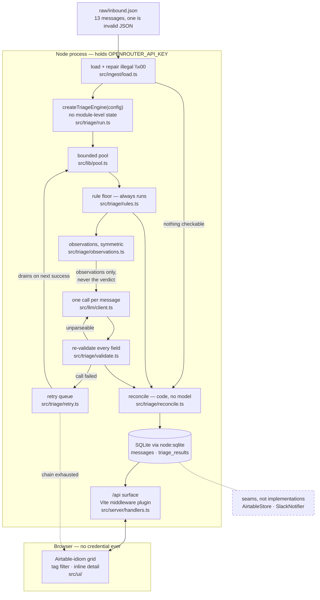

# Inbound Triage Assistant — design

Take-home for the Arootah AI Product Engineer role. Written before the build, and kept as the design
record rather than rewritten to match what shipped: where the build diverged, the divergence is marked in
place. The shipped taxonomy is six categories, not the seven in section 4.2.

**The brief is rule of law.** Where a preference of ours collides with it, the brief wins and the
collision is recorded here rather than quietly resolved. Three collisions were found at design time;
all three are named in §2 and reconciled in the design.

---

## 1. What the brief requires (the contract)

Restated from the brief, because everything below is measured against it.

| # | Requirement | Where it lands |
|---|---|---|
| R1 | List the ~13 inbound items in a simple front end | `src/ui/Queue.tsx` |
| R2 | Call an LLM **per item** → summary · category · priority · next action | `src/triage/run.ts` |
| R3 | Display results clearly (sort/filter = nice-to-have) | `src/ui/` |
| R4 | Survive a malformed message **and** an API error without falling over | `src/ingest/load.ts`, `src/triage/validate.ts` |
| R5 | React preferred | yes |
| R6 | Data layer: Airtable **or** local store (SQLite / JSON) — either scores full marks | SQLite |
| R7 | Any LLM, but a **current, valid model ID** | verified against the live catalogue |
| R8 | API key **server-side, never in the browser** | Node process only, §5 |
| R9 | Out of scope: auth, deployment/Docker, coverage targets, telemetry, multi-user | not built |
| R10 | Keep it small; don't gold-plate; single-user local tool is "exactly right" | scope discipline, §2.3 |

Deliverables: repo with ≥3 meaningful commits · **RATIONALE.md answering five questions** · README ~1 page incl. an Airtable-modelling note and one n8n/Zapier automation note and one
example of overriding the model · `prompts/` folder · `.env.example` · Loom ≤3 min showing one
failure case handled.

---

## 2. The three collisions, and how they resolve

### 2.1 "Triage needs to be deterministic" vs. R2

R2 mandates an LLM call per item. A fully deterministic triage would violate the brief outright, so
"deterministic" cannot mean "no model." Separately, **temperature 0 is not a determinism guarantee** —
identical input can still yield different output across batching and provider-routing differences.
Determinism therefore lives in the *envelope*, not in the model:

1. **Closed output space.** `category` and `priority` are enums in a `strict` JSON schema with
   `additionalProperties: false`. The model selects; it does not invent labels.
2. **Re-validation after the schema.** Structured output is a strong hint, not a guarantee — every
   field is checked again in code before it is trusted.
3. **A deterministic rule floor that always runs.** Regex signals produce a category and priority for
   every message independently of the model.
4. **Deterministic reconciliation** (§4.3). Explicit signals in the text — a self-identified existing
   client, a named deadline, a stated complaint — override the model's priority by rule, not by asking
   it again.
5. **Deterministic fallback.** No key, a dead key, a 429, a timeout, or an unparseable reply all land
   on the rule floor's answer, labelled as such. Never a silent degradation.
6. **Stable ordering and a cache.** Results are keyed by message id and content hash, so re-running
   the queue does not re-roll answers already computed.

The two prose fields the brief requires (`summary`, `next_action`) are genuinely model-authored. They
cannot be made deterministic and are not pretended to be — they are bounded (single line, length-capped
in validation) and clearly attributed in the UI to `model` or `rules`.

### 2.2 "Lightweight React app, no Electron" vs. "I choose a lightweight electron app"

Both sentences are Joel's, from the same message, and they contradict each other. **The design follows
no-Electron**, because that is the explicit instruction, it is what the stated reasoning argues for
("just need a UI that can show the work, not do heavy lifting; simpler is less things that can break"),
and R9/R10 point the same way — Electron is a packaging and deployment concern the brief puts out of
scope.

### 2.3 "Multiple instances spun up as needed / workers at a threshold" vs. R9 + R10

R9 rules out multi-user and deployment and R10 says don't gold-plate, so a worker pool or instance
orchestration would be building the wrong thing — while the thinking behind it is exactly what rationale
question (e) asks for ("what breaks at 10,000 messages a
day"). The split:

**Built now** (small, and genuinely needed for a 13-item queue):
- A bounded-concurrency limiter (~20 lines, `src/lib/pool.ts`, `TRIAGE_CONCURRENCY`, default 4). Without
  it the queue is either serial and slow, or unbounded and rate-limited.
- **No module-level state anywhere in the pipeline.** `createTriageEngine(config)` returns an instance;
  N instances can coexist in one process. This is what "instantiable" costs when you never reach for a
  singleton: nothing.

**Documented, not built** — the scale plan in RATIONALE.md (e): worker threads past a queue threshold,
a durable job table with lease/claim semantics instead of in-memory state, batch embedding-based
pre-classification to cut model calls, provider rate-limit budgeting.

---

## 3. Assumption tests run before this design was accepted

| Assumption | Verdict |
|---|---|
| An 8B llama handles structured outputs on OpenRouter | **PASSES.** `meta-llama/llama-3.1-8b-instruct` reports `structured_outputs: true` and `response_format: true` in the live catalogue (415 models, read 2026-08-18). $0.05 in / $0.08 out per million. |
| Cheap models are safe by default | **NO — endpoint-level trap confirmed.** `qwen/qwen3-8b` reports `response_format: true` and `structured_outputs: false`: it looks like a sensible cheap choice and would return prose with a 200. Support is a property of the *endpoint*, not the model, so `provider: { require_parameters: true }` is mandatory alongside a capability-checked registry. |
| "Least cost" discriminates between models at this volume | **NOT AT 13 MESSAGES.** Whole-queue cost: 8B ≈ **$0.0003**, llama-3.3-70b ≈ $0.0008, claude-haiku-4.5 ≈ $0.011. The brief itself says "cost is pennies." Cost only becomes a real criterion at scale — at 10k messages/day: 8B ≈ $0.22/day, 70B ≈ $0.63/day, haiku-4.5 ≈ $8.46/day. So the honest reading of "accurate triage for least cost" is: **choose on accuracy at this volume, and show the cost curve for scale.** Notable: `llama-3.3-70b-instruct` is $0.10/$0.32 — cheaper than `gpt-4o-mini` and close to `gpt-4.1-nano`. |
| An 8B triages this data *accurately* | **UNVERIFIED — needs measurement, not assertion.** §7 makes it a measured step. This also produces rationale answer (c) honestly. |
| SQLite is available without an install risk | **YES, natively.** `node:sqlite` (`DatabaseSync`) works on the installed Node v24.14.0 with zero dependencies and no native compile. It prints an `ExperimentalWarning`. `better-sqlite3` is the mature alternative but is a native module whose install can fail without build tools — a real risk to anyone running this from scratch on a machine that is not ours. Open decision, §8. |
| North Star is the right source for the model connection | **PARTLY.** Its transport is hardwired to classify/compose and its proxy lane returns a fake `offline` failure. proof-of-work's `openrouter/` layer is the better lift (generic `callJson<T>`, capability registry, injectable fetch, surfaced 400 bodies). North Star wins on the *classification* pattern: its rule floor, `IntentProvider` seam, confidence threshold, and re-validate-everything discipline. Take both, from the right places (§6). |
| North Star's schema guard can be imported as-is | **NO.** Its `tests/schema.test.ts` fails any string leaf without an enum and bans fields named `summary` — but R2 *requires* a model-authored summary and next action. The guard is adapted, not adopted: closed enums for category and priority, bounded-and-validated prose for the two text fields. |

---

## 4. Architecture



The two things this diagram is drawn to make obvious: **the key never crosses into the browser box**, and
**reconcile takes two inputs and calls no model** — the rule floor and the LLM meet in ordinary code.

### 4.1 Ingest — `src/ingest/load.ts`

`raw/inbound.json` **is malformed at the FILE level, not just the item level**: `inb-011`'s body carries
`\x00` escapes, which JSON does not define, so a strict `JSON.parse` of the whole file fails outright rather
than yielding twelve good items and one bad one. The loader therefore reads text, repairs known-illegal escape
sequences, and parses; on total failure it reports the parse error rather than crashing.

The brief prints its sample data in Appendix A rather than shipping a file, so this file is a transcription of
it. Whether the escapes were authored there or introduced in transcribing it, the decision they force is the
same, and it is the one worth defending: **repair at load time rather than sanitise the source.** Hand-editing
the fixture would have been quicker and would have destroyed the edge case the brief asks the tool to
survive.

Per-item validation is separate, and D-011 sets its shape: an item missing `id`, or with a body under a
content threshold, becomes a **real row in the queue** with `category: unreadable`, a low confidence score,
and a `reason` (`empty-body`, `garbled`, `no-id`). It never reaches the model — spending a call on `"."` is
waste — and it is still `status: triaged`, because we *did* finish: the answer is "there is nothing
checkable in here."

This replaced an earlier design that parked malformed items in a separate bucket. One list with
`unreadable` as another tag is the right shape for an Airtable-idiom grid (§8); a parking bucket would have
been a second surface for the reader to go find.

### 4.2 Taxonomy — `src/triage/types.ts`

Seven categories, closed: `prospect` · `existing_client` · `vendor` · `partner_referral` · `noise` ·
`unknown` · `unreadable`.

**Superseded, and this section is kept as the design-time record.** The set grew to nine when the
never-firing guards made `fraud_risk` and `compliance` reachable, then settled at **six**: `vendor`,
`automated` and `unreadable` collapsed into `junk`, and `partner_referral` folded into `prospect`. Both
moves and the reasoning for them are recorded further down. The shipped set is `src/triage/types.ts`.

`partner_referral` exists because `inb-007` (an RIA proposing a referral arrangement) is neither a
prospect nor a vendor, and collapsing it into either loses the routing decision that matters.

**The last two are deliberately different things** (Joel's assignment):

| Label | Means | Example | Next action |
|---|---|---|---|
| `unknown` | a **valid** message whose intent cannot be determined | `inb-009` — "just following up… let me know the next step", real correspondence referring to a conversation the inbox has no record of | reply and ask |
| `unreadable` | nothing checkable in the message at all | `inb-010` is a single period; `inb-011` is truncated MIME garbage | discard, or check the intake form |

One of the two has to exist regardless: a queue where everything is confidently categorised is a flattery
generator, and a reader can tell.

**`unreadable`, not `error`**. `error` as a *category* would have sat beside API failures that are
colloquially errors but are a *status*, so someone scanning `ERROR` chips could read "the app broke"
rather than "this message is garbage." `unreadable` removes the collision outright and is more precise than
`malformed`: it covers an empty body as naturally as a corrupted one, where "malformed" implies a structural
violation that `"."` does not have. It also pairs cleanly — `unknown` is *we can't tell what they want*,
`unreadable` is *we can't read it at all* — and it matches vocabulary already in use in the sibling repo
(`UnreadablePostingError`).

### 4.2b Two orthogonal fields, not one status

D-011's other consequence. `category` says *what the message is*; `status` says *whether we finished*.

| Case | category | status | confidence | source |
|---|---|---|---|---|
| Normal message | one of the seven | `triaged` | model's | `model` / `reconciled` |
| Nothing checkable in it | `unreadable` | `triaged` | low, deterministic | `rules` |
| Any model failure | **none asserted** | `pending_retry` | — | — |

Collapsing these into one field is what forced the parking bucket in the earlier design. Keeping them
apart means a failed call never has to pretend to be a category.

**D-011b resolved (3b): a failed call asserts no verdict at all** — no category, no priority, no rule-floor
stand-in. The row shows the failure kind, the attempt count, and nothing it cannot stand behind.

### The queue is deferred work, not outage recovery

Claude's first taxonomy split failures into "transient, so queue" versus "permanent, so terminal", and put a
rejected key in the second bucket on the grounds that retrying cannot fix a bad credential. **Joel overruled
it, correctly:** *"rejected key means they need to change the key — that's exactly the use case for queueing,
until they make a valid key or fund the current one."*

The flaw was in the framing. A retry queue is not a mechanism for waiting out an API outage; it is a record
of **work we could not do yet**, and it drains whenever the blocking condition clears — whether that is the
provider recovering *or the operator fixing something*. Under the narrow reading, a 401 discarded thirteen
items' worth of pending work at the exact moment the fix was one environment variable away.

| Failure | Behaviour | Drains when |
|---|---|---|
| **No key configured** | **the app refuses to start**, naming the variable and pointing at the README (there is no keyless mode) | n/a |
| **Key rejected / unfunded** (401, 403, 402) | `pending_retry`, banner names exactly what to fix | the operator sets a valid or funded key and re-runs |
| **Transient** (429, timeout, 5xx, network) | `pending_retry` | the provider answers again |
| **Unparseable reply** | falls through the model chain first (below), then `pending_retry` | a later attempt parses |

Nothing is silently abandoned. Attempts are capped and the count is on the row, so a message that has
exhausted its cap reads *"could not triage — 3 attempts across 2 models, last failure: schema violation"*
and stays manually retryable. That is terminal in effect and honest on its face, which is the property
worth having.

**Model fallthrough on an unparseable reply**. OpenRouter's own `models` array only falls through on
*provider* errors — a 200 containing prose is a success as far as it is concerned, so it will not retry.
The fallthrough therefore has to be ours: on a reply that fails validation, re-request with the next model
in the chain explicitly, up to the chain length. The chain is capped at 3 (OpenRouter rejects a longer
`models` array with a 400, and a 400 does not fall through — the trap already guarded in §6). One cause is
deliberately excluded: a reply truncated at `max_tokens` is not a model-quality problem, so it raises the
cap and retries the *same* model rather than burning a chain slot.

### No keyless mode — the tool ships key-configured

Joel: *"I dont want it to ship keyless, it should be key configured ready to go. changing the key needs to
be a config change documented in the readme."* Keyless mode is **cut**, and this is the same rule as D-010
applied one layer up: a degraded mode is a cushion for a stated requirement, and the requirement here is
R2 + R8 — an LLM call per item, with the key server-side. A keyless mode that quietly serves rule-based
output does not meet that requirement, it only looks like it does, and looking like it is the worse
failure: the operator cannot tell which layer produced the row they are acting on.

**What "server-side" means here, and it is already the design.** The key is read from the environment by
the Node process (`loadEnv(mode, cwd, '')` — empty prefix, so it never reaches `define`), used to build the
request inside `/api`, and never sent to the browser. Changing it is a one-line edit to `.env`, documented
in the README. No `VITE_`-prefixed variable ever holds a credential.

**What cannot be done: shipping the key's value.** A key committed to the repo is a secret in git — the
brief's own deliverable list says "never commit secrets", provider keys in public repos are scraped and
drained within minutes, and on an *AI Product Engineer* application a committed credential is the one
defect nobody misses. So whoever runs it supplies the key; the app supplies everything else. Behaviour with no key set is now a **refusal with a legible message**, not a silent downgrade:

```
$ pnpm dev
✗ OPENROUTER_API_KEY (or ANTHROPIC_API_KEY) is not set.
  Copy .env.example to .env and add a key — see README "Quick start".
  This tool calls an LLM per message; there is no offline mode by design.
```

That is the same shape as the Node-version preflight (§4.4): fail fast, name the fix, no cushion. The rule
floor still exists and still runs — it is one half of the reconciliation (§4.3), not a fallback mode.

### 4.2c The retry queue — `src/triage/retry.ts`

D-011: an API error fails loudly and the item queues itself to be categorised when the API answers again.

- On a typed model failure (`no_key`, `rate_limited`, `timeout`, `bad_response`), the item is written
  `pending_retry` with the failure kind and an attempt count. **The run continues** — one dead call does
  not abort the other twelve.
- The queue drains on the **next successful call within the run**, which is what makes it automatic in the
  common case: the API blips, four items fail, the fifth succeeds, and those four are retried before the
  run reports done.
- If *every* call fails there is no success to trigger a drain, so the queue waits for the next run or an
  explicit **"Retry N pending"** control. The header states the pending count.
- **The scope boundary, stated because this is the part that could balloon**: no background timer, no
  polling health-check (that edges into §1's telemetry exclusion), no exponential-backoff daemon. Attempts
  are capped and visible. Status persists in SQLite, which is already there.
- **The honest limit, and it goes in the README**: the app cannot detect that the API was restored without
  probing it. It says "13 pending retry" rather than implying a watcher that does not exist.

### 4.2d The error surface — when the fallthrough itself fails

Joel: *"if the fallback fails we need to make an error surface."* A row quietly sitting in `pending_retry` is
not loud enough when the model chain has been exhausted — that is the case where a human genuinely has to
decide something, so it gets a surface of its own rather than a status someone might scroll past.

Three levels, aggregate down to detail:

1. **A run summary bar**, always present after a run, stating what happened in one line:
   *"11 triaged · 2 could not be triaged — schema violation, 3 attempts across 2 models."* With a
   **`Retry 2 pending`** control beside it. A clean run says so; it is never blank.
2. **A filter chip in the grid** for `pending_retry`, sitting alongside the category filters, so the failed
   rows are one click away and countable — which is what D-008's Airtable idiom is good at.
3. **Per-row attempt detail on expansion**: each attempt with its model slug, HTTP status, failure kind and
   timestamp. That is what makes a failure diagnosable instead of merely visible, and it is the difference
   between "it broke" and "`llama-3.1-8b` returned prose twice, then `gpt-4.1-nano` truncated at
   `max_tokens`."

The distinction being drawn: a queued item is *work pending*, a chain-exhausted item is *an outcome
requiring attention*. Both are visible; only the second one gets the summary bar's headline. This also
gives the Loom its second failure beat — the API-error path — alongside the unreadable message.

Priority is `high` · `medium` · `low`, defined by **deadline and money at risk**, not by tone.

**Both are declarative data, not code branches** — and this is the answer to rationale question (a),
"how your data model would hold up if the taxonomy doubled." A category is a row: label, description,
weighted evidence, routing hint. A priority modifier is a row: the signal, its signed points, and which
categories it applies to. Growing the taxonomy adds rows and one line per new label in the schema enum; it
adds **no** new `if` branch, no new table, and no migration beyond an insert. The schema enum is generated
from the same rows, so a category cannot exist in the data and be un-selectable by the model, or vice
versa — a test pins that.

**This was exercised in both directions rather than asserted.** The taxonomy grew from seven to nine when
the never-firing guards made `fraud_risk` and `compliance` reachable, then shrank to six when
`vendor`, `automated` and `unreadable` collapsed into `junk` and `partner_referral` folded into `prospect`. Growing cost two rows in `CATEGORIES`, two in
`CATEGORY_EVIDENCE`, two in `CATEGORY_PRIORITY_FLOOR` and four corpus rows. Shrinking cost less: three
evidence lists merged into one, and the modifier exception lists got *simpler* — several rows had named
three excluded categories plus `vendor` a fourth time, and now name one. No branch changed either way. The
`Record<Category, …>` types refused to compile until every label had declared evidence and a floor, which
is what makes the claim checkable instead of hopeful.

**Where the taxonomy is cut is a product decision, not a modelling one.** The tool exists to catch leads and
rank existing clients, so everything on that path gets its own label and everything off it is one bucket.
The distinctions inside `junk` are real — a recruiter is not a newsletter, and a newsletter is not a
corrupted body — but none of them changes what an operator does, and a taxonomy that splits hairs nobody
looks at spends its discrimination in the wrong place. What was worth keeping from `unreadable` is not the
label but the **`reason`** on the row: *"the body is transport damage"* tells an operator the intake path
may be broken, which is actionable in a way a separate category never was.

`partner_referral` folded into `prospect` rather than into `junk`: a peer proposing mutual referrals is on
the path of new business, and whether they arrive as a lead or as a channel does not change that business
development has to answer them. The routing line still names the difference and the model's per-message
`next_action` says it concretely — which is where a distinction belongs once it stops deciding anything
structural. The two referral *signals* stay split, because what the text contains genuinely differs.

`unknown` deliberately did **not** collapse into `junk`. Junk means we know the message is off the path;
unknown means we cannot tell, and a vague message from a real person may be the lead. Binning it would
defeat the purpose the rest of the taxonomy is cut for.

#### The signal model — weighted, signed, and direction-aware

Three rules do the work, and each replaced something simpler that measurement showed could not work.

1. **Weight is evidential strength, 1–5.** Asking about account minimums scores 2, because a competitor or
   a tyre-kicker asks it too. Stating that you sold your business scores 5, because it is a fact the sender
   volunteered about their own circumstances and fits almost nothing else. *This replaced counting matches,
   which discriminated nothing:* the supplied messages average 125 characters and 22 words, so a message
   never contains three redundant phrasings of one intent, and every category verdict scored exactly 0.65
   — `0.5 + 1 × 0.15`. The confidence function was documented as rising with agreement while being unable
   to rise in practice.

2. **Direction and possession decide sign, not the noun — and never the amount.** *Our invoice* is a vendor
   billing us; *the invoice you sent* is a client asking about ours. *To invest* is money arriving; *payment
   is due* is money leaving. One determiner apart, opposite meaning, so the patterns capture the determiner.
   An amount is captured into the detail and **never scored**: `$8M` appears both in *"I have $8M to
   invest"* and in *"our platform manages $8M for firms like yours"*, and only direction separates the most
   valuable message in the queue from a cold pitch. Two earlier designs — a dollar threshold, then magnitude
   tiers — were rejected for the same reason: a threshold has to be a number, any number is a business rule
   about who this firm wants, and tiers trade one arbitrary boundary for three.

3. **Priority is a second, independent sum:** the category's own floor plus signed modifiers. A stated
   deadline adds 2, a third-party requester adds 1, and *"no rush at all"* subtracts 1 — a sender who
   disclaims urgency has told us something, and scoring that identically to silence discards it. Sales
   evidence **suppresses** the money escalation entirely, which is rule 2 doing the work.

Subtraction is safe here because reconciliation still takes the **higher** of the rule and model
priorities (§4.3): this layer can lower its own read and can never lower the final verdict below what the
model concluded.

Confidence now moves on evidential weight **and** on the margin over the runner-up. Separation is what the
count could not see — two categories tied on weak evidence is a genuinely uncertain read, and it now lands
*below* the threshold at which this layer may override the model. On the supplied queue the verdicts spread
across six distinct confidence values instead of one.

Weighting also removed an accident. Ties used to break on whichever category was declared first, and on the
client-referred prospect that arbitrary order was the only reason the right answer came out.

What *would* strain at double: prompt length (the taxonomy is injected, so twelve definitions is a
larger system prompt), and confusability between neighbouring labels — the honest failure mode is not
capacity but discrimination, which is why `unclear` and a confidence threshold matter more as the
taxonomy grows, not less.

### 4.3 Reconciliation — `src/triage/reconcile.ts`

Where "deterministic" is actually enforced. Rules and model each produce a verdict; the merge is:

- Category: the model's, unless the rules found an **explicit self-identification** ("I'm an existing
  client", "I'm a client") — that phrase is a fact in the text, not a judgment call.
- Priority: **`max`** of the two, so a rule that spots a hard deadline or a disputed fee can only raise
  urgency, never lower it. A model that under-reads an angry client is the expensive failure direction; a
  false high costs one human glance. This is also what makes the rule layer's own negative modifiers safe:
  `no_urgency` can lower the floor's read and can never lower the merged verdict.
- Confidence below threshold, or any typed model failure, → the rule floor's verdict, labelled `rules`.
- Every row records `source: model | rules | reconciled` and, when reconciliation moved something, why.

This is the mechanism that makes "reasoning disparity can be accounted for with a deterministic system"
true rather than aspirational — and it is what lets a cheap model be a defensible choice.

### 4.4 Store — `src/store/`

`Store` interface, `SqliteStore` implementation, `AirtableStore` **left as a documented seam** (the
interface exists; the adapter is the migration path, not built now — R9/R10). **Two** tables:
`messages` · `triage_results`. The third (`parked`) is gone — D-011 turned parking into a category, so a
malformed item is an ordinary result row rather than a separate table. `triage_results` carries `category`,
`priority`, `summary`, `next_action`, `confidence`, `source`, `status`, `attempts` and `failure_kind`.
Results are keyed `{message_id}` with a `content_hash`, so a re-run is idempotent and an edited message
re-triages.

**Exactly one store ships, and there is no fallback**. A JSON fallback was proposed as insurance
against an old Node runtime and rejected: it would carry a second code path that nothing exercises, and it
would silently remove the scalability property SQLite was chosen for in the first place — robustness in
appearance, a quiet downgrade in fact. The runtime requirement gets *stated*, not cushioned:

- `engines: { "node": ">=24.0.0" }` (raised from >=22.13.0 on 2026-09-05 after CI on Node 22 found `node:sqlite` truncating a stored string at the first NUL byte — see commit 21ee13d)
- a committed `.nvmrc`
- a preflight in `pnpm dev` that fails with **"needs Node >=24.0.0, you are on X"** rather than a raw
  `ERR_UNKNOWN_BUILTIN_MODULE`

Failing fast with a legible message is the correct behaviour here, not an exception to R4 — R4 is about
surviving bad *data* (a malformed message, an API error), not about papering over a wrong runtime. The
floor was originally set at the flagless `node:sqlite` version (22.13.0, January 2025) so every currently-supported Node line cleared it; it was raised to 24.0.0 on 2026-09-05 once CI on Node 22 showed `node:sqlite` truncating a stored string at the first NUL byte, which the supplied inbox contains (commit 21ee13d).

### 4.5 Integrations — the open spaces

D-007: `src/integrations/notify.ts` defines one interface with a `ConsoleNotifier` **implemented and
actually wired**, plus `SlackNotifier` as a documented stub. Joel's reasoning — "a slot for an evolution
without building the thing needed" — and the distinction that keeps it honest is that the interface has a
real implementation running through it. An interface with zero implementations is a guess; one with a
working implementation is a seam. The stub's own comment and the README both have to say *seam, by
choice*, or a reader takes it for an unfinished feature.

The Slack trigger→action pair (a `high` verdict written → post to a channel) doubles as the n8n/Zapier
automation the README deliverable asks for. Airtable gets the same treatment one layer down: the `Store`
interface is real and has a working SQLite implementation, so `AirtableStore` is a named migration path
rather than an abstraction invented for a document.

---

## 5. Where the key lives

Vite dev-server middleware (`configureServer`) mounts a small `/api` surface; the OpenRouter key is
read with `loadEnv(mode, cwd, '')` — **empty prefix, so it is never handed to `define`** — and stays in
the Node process. The browser posts `/api/triage/run` and never sees a credential. No `VITE_`-prefixed
variable ever holds a key; a `VITE_` prefix is a promise to bundle the value into client code.

This is also why SQLite and R8 reinforce each other rather than competing: both need a Node process, and
there is exactly one.

**A Node runtime is irreducible here, and that is a finding rather than an assumption.** An LLM key is a
bearer secret sent verbatim in a request header, so whichever process builds the request holds the
plaintext key; if the browser must not hold it, a non-browser process must, and a process needs a runtime.
Every browser-only variant fails R8 — including WASM SQLite, which additionally will not load from
`file://` in Chrome. The vendor gate for browser-direct calls is a flag named `dangerouslyAllowBrowser`,
which is its own argument.

What *can* be done for someone with no local Node: commit a `.devcontainer/devcontainer.json`, so the
repo opens in GitHub Codespaces with nothing but a browser. A few lines of JSON, the key still
server-side, and not deployment. This is the answer to "can it run without Node" — not by removing the
runtime, but by not requiring it to be *theirs*.

## 5b. Prompt architecture — what the model is told, and what it is not

The rule layer briefs the model; it does not vote in front of it. Grounded in a research pass whose
claims were adversarially refuted, so the weak parts are labelled as weak:

- **Observations in, conclusions out.** The model receives the raw message text *plus* a symmetric
  observation list — every signal reported with its absence, dates ISO-normalized, no rule weighting in
  the ordering. It never receives the rules' verdict. Injecting a suggested answer is measured at up to a
  36-point accuracy loss on reasoning benchmarks, sycophantic flips of correct answers reach ~98% under
  mild challenge, small models are more susceptible than large ones, and — the part that makes it
  dangerous rather than merely lossy — **the hint is absorbed silently**, so the model's prose still reads
  as independent reasoning. If the model echoed the rules, reconciliation would be theatre: agreement
  would rise, which reads as validation.
- **Honest labelling of the weak half.** That observation-injection *improves* accuracy is a defensible
  extrapolation, **not** a documented result — no published study injects per-instance extracted facts
  into a classifier prompt, and the nearest test of this exact shape found marginal-to-negative gains from
  disclosure, with the value coming from treating disagreement as a trigger. RATIONALE.md says this in
  those words rather than citing a number that measures something else.
- **Field order is load-bearing.** Generation is autoregressive, so the schema emits `summary` and the
  evidence fields **before** the `category` and `priority` enums. What is generated first conditions what
  follows; putting the enums first would have the label decided before the reasoning that justifies it.
- **Sized for an 8B.** Prompt budget goes to explicit taxonomy definitions and explicit decision criteria, with
  enum-constrained decoding. No chain-of-thought (net negative below ~10B) and no self-consistency
  (measured to hurt Llama-3-8B on hard items). Few-shot only if it earns its place, and then
  label-balanced, k=4–8, order pinned — example ordering alone can swing accuracy ~30 points.

---

## 6. What is lifted, and from where

| From | What | Why |
|---|---|---|
| proof-of-work `src/openrouter/{client,protocol,schemas}.ts` | transport, model registry with capability flags, `buildJsonRequest`, ≤3-model chain cap, `require_parameters`, typed failure kinds, injectable `fetchImpl` | generic over schema; both OpenRouter traps already guarded and regression-tested |
| proof-of-work `vite.config.ts` plugin · `src/server/handlers.ts` · `src/server/persistence.ts` | the whole server shape and the persistence seam | exactly the target shape; `persistence.ts` is where SQLite slots in |
| proof-of-work `tests/model-proxy.test.ts` | the `recordingFetch` harness | asserts the *real* request body, not the options object |
| North Star `src/intent/rules.ts` · `src/intent/types.ts` | rule floor, `IntentProvider` seam, confidence threshold, "no match → unknown at 0", tie-break by declaration order | the deterministic floor, already battle-tested on real phrasings |
| North Star `parseClassification` | re-validate every field after the schema | plugs proof-of-work's unchecked `parsed as T` cast |
| North Star `tests/intent-corpus.test.ts` · `tests/live-llm.test.ts` | phrasing corpus; gated live test incl. spend-cap check | how you prove a classifier works without "it worked when I tried it" |
| North Star `src/ui/App.tsx` in-flight guard | `if (!text \|\| loading) return` + `finally` | prevents concurrent duplicate runs |

Two fixes applied to lifted code: drop the 45s timeout to ~20s (per-message triage, not long
extraction), and replace `parsed as T` with real re-validation. **Do not** carry over `minimum`/`maximum`
in the JSON schema — both repos record that as a hard 400 on some providers that silently killed the
model path. Range checks belong in validation.

---

## 7. Measuring the model choice (rationale answers (c) and the model decision)

D-006/D-009 resolved: **measure it.** One script, `scripts/eval.ts`, runs the 13 messages through three
prompt arms and reports.

| Arm | Prompt contains | Purpose |
|---|---|---|
| 1 · blind | the message only | baseline |
| 2 · +observations | message + rule findings, **no verdict** | the design under consideration (§5b) |
| 3 · +verdict | message + the rules' conclusion | **the control** — built to be rejected |

Reported per arm: per-field agreement with Joel's labels, rule/model agreement, cost, latency, and the
**blind-to-primed flip rate split by whether the rules were right**.

Arm 3 exists to test Claude's own claim on this data rather than to ship. If agreement rises from arm 2 to
arm 3 while accuracy does not, that is capitulation — measured here, with this model, on these messages —
which converts a cited paper into an observation about this system, on this data. That is the strongest
available material for rationale answers (b) and (c).

**Joel labels only the rows where arms disagree**, not all 13 — the brief never asks for a labelled set, so
a full gold standard would be gold-plating. The labels that do get written are his: a label written by the
system under test proves nothing.

**Scope guard**: one file, no framework, no fixtures beyond the 13 messages and the disagreement labels. If
it grows past a single file it has stopped being the right size.

---

## 8. Front end — an Airtable-idiom grid

D-008: a tag-sorted list with a filter bar and inline expanding detail, deliberately imitating an
Airtable grid. Sorting and filtering are only a nice-to-have under R3, so this sits just above the MVP
line — but it earns its place twice: the Arootah role requires Airtable fluency, and the README
deliverable asks how this would be modelled in Airtable. **An Airtable-idiom grid makes the interface
the visual answer to that written question.** Category and priority render as tag chips; a row expands
in place to show the summary, next action, the verdict source (`model` / `rules` / `reconciled`), and for
parked items the park reason.

The line to hold: imitate the grid *idiom* — chips, inline expansion, a filter bar — not Airtable's
chrome. The resemblance should read as fluency, not as a knockoff.

## 9. Decisions — all settled

Each row is the settled call. The reasoning behind it is in the section that argued it.

| # | Decision |
|---|---|
| D-001 | React + Vite, no Electron |
| D-002 | SQLite, because JSON does not scale and embeddings come later |
| D-003 | Cheap OpenRouter model, gated on verified structured-output support |
| D-004 | Determinism as an envelope, not a replacement for the model |
| D-005 | `node:sqlite` — fewest failure modes, `engines: >=22.13.0` |
| D-006/D-009 | Measure three prompt arms; ship what the evidence supports |
| D-007 | Working `ConsoleNotifier` + documented Slack stub |
| D-008 | Airtable-idiom grid: tag-sorted, filterable, inline expansion |
| D-010 | One store, no fallback — state the requirement, don't cushion it |
| D-011 | Unreadable → a real row; a failed call → queued, no verdict asserted |
| D-012 | `unknown` = ambiguous intent · nothing checkable in the body is `junk`, reason on the row |
| D-013 | Queue is deferred work: credential failures queue too · our own model fallthrough on unparseable · exhausted chain gets an error surface |
| D-014 | No keyless mode — ships key-configured; no key means refuse to start, never degrade |
| D-015 | Skipped — OpenRouter only; the brief does not require Claude |
| D-016 | Skipped — no key-holding relay; the runner supplies the key |

**All sixteen decisions settled. The design is locked.**

Two arguments for a key-holding relay were withdrawn as unsound: that a relay would violate the
no-deployment rule (it would not, a relay is not the app), and that someone holding only an Anthropic key
would hit a wall (a papercut, and the walkthrough recording covers it).

---

## 10. Deliberately not built

Auth · deployment/Docker · telemetry · multi-user · worker threads · instance orchestration · an
Airtable adapter · a Slack client · retry beyond one honest attempt · embeddings. Each is either
explicitly out of scope per R9, or scope discipline per R10, and each is named in RATIONALE.md as a cut
rather than an omission.

---

## 11. What shipped, and what it cost

Written after the build, unlike the rest of this document.

**Six categories**, cut where the product is cut: `prospect`, `existing_client`, `fraud_risk`, `compliance`,
`unknown`, `junk`. Anything off the path of a new or an existing client is one bucket. `unknown` stays its
own label because `junk` means we know it is off that path and `unknown` means we cannot tell, so it floors
at medium rather than low — a vague message may be the lead the tool exists to catch.

Categories and priority modifiers are **rows** in `src/triage/types.ts` and `src/triage/rules.ts`, not `if`
branches. `Record<Category, ...>` refuses to compile until a new label declares both its evidence and its
priority floor, which is what makes "the taxonomy could double" a checkable claim rather than a hopeful one.
The deterministic layer scores every message from 23 signals and `src/triage/reconcile.ts` merges its verdict
with the model's. The model never receives that verdict, only the signal readings.

**SQLite over Airtable and over a JSON file.** `node:sqlite` is built in, so the dependency count stays at
what Vite and React need, and a JSON file would be rewritten whole on every result.

**OpenRouter over a direct provider call**, which makes the model a one-line config change and made it
possible to measure four models against each other on the same queue.

**`llama-3.3-70b` over the cheaper 8B.** Both scored well on the supplied thirteen, which is exactly why the
supplied thirteen could not decide it. Against sixteen held-out messages whose phrasings the patterns had
never seen, the 8B got half the categories right and the 70B three quarters, for $1.79 against $1.18 per ten
thousand messages a day. `anthropic/claude-haiku-4.5` scored highest of the four measured, at roughly fifteen
times the 70B's cost for one extra correct row out of twelve, so it stays available through `TRIAGE_MODEL`
rather than shipping as the default. Full table: `eval/README.md`.
